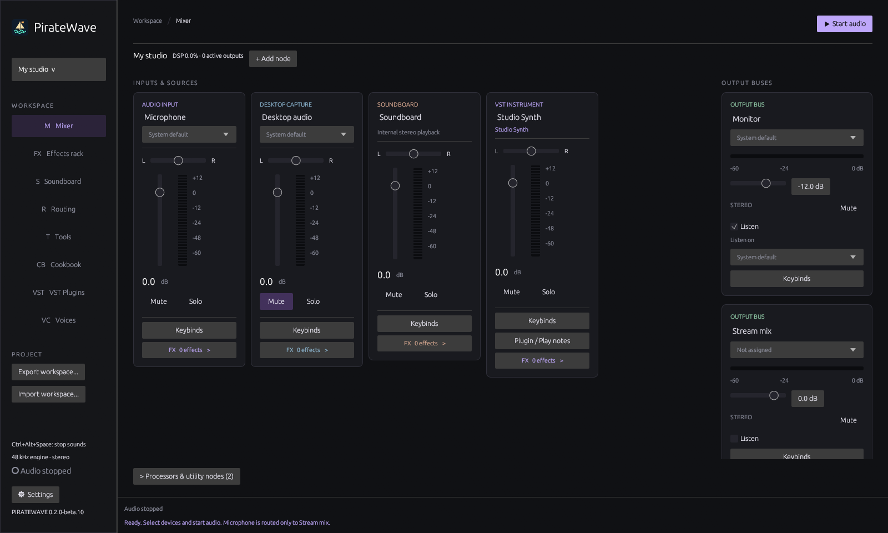

# PirateWave

A Windows desktop audio workspace for routing microphones, applications, soundboards, and effects into your stream and headphones. Built in Rust with a native egui interface.

PirateWave is in beta. Optional voice conversion and local voice training have additional hardware and quality limitations; read their guides before installing models or tools.



## Features

- Physical and virtual audio devices, desktop loopback, and individual application capture.
- Visual routing with processors, switches, recording nodes, and automatic ducking.
- Microphone cleanup, RNNoise suppression, dynamics, EQ, pitch correction, modulation, delay, and reverb.
- Soundboard playback, global shortcuts, recent-history recording, cropping, and WAV/MP3 export.
- Autosaved workspaces and five importable **Cookbook** recipes.
- Loupedeck and Stream Deck controls, VST hosting, and extensions for custom nodes and effects.
- Audio checks, test signals, references, and controller-icon creation on the **Tools** page.

## Get started

Use a portable build from this repository's **Releases**, when available, or the `PirateWave-windows-x64` artifact from a successful GitHub Actions run. You can also build from source below. Extract the entire folder and run `PirateWave.exe`; keep its helper executables and DLLs together.

Windows x64 is the supported desktop target. If Windows reports a missing C++ runtime, install the [Microsoft Visual C++ Redistributable](https://learn.microsoft.com/cpp/windows/latest-supported-vc-redist): x64 for PirateWave and x86 for 32-bit VST plugins. The executable is currently unsigned.

1. Choose a microphone in **Mixer** and check the **Monitor** output. Prefer headphones.
2. Assign **Stream Mix** to your output device. To send the mix to Discord, OBS, or a game, follow [Virtual audio device setup](#virtual-audio-device-setup) below.
3. Review connections in **Routing**, or import a **Cookbook** recipe. Select the devices, application targets, and optional voice packs needed by that workspace.
4. Click **Start audio**. Audio starts stopped by default.
5. Add processors in **Effects rack** and clips in **Soundboard**. The default `Ctrl+Alt+Space` shortcut stops soundboard playback; customize shortcuts in Settings.

The initial workspace routes Microphone and Desktop audio to Stream Mix, and Soundboard to both buses. Desktop capture starts muted, Stream Mix starts unassigned, and Monitor starts at -12 dB. The microphone is not initially connected to Monitor.

Workspaces autosave. The workspace menu creates, renames, clones, switches, and deletes them. **Export workspace** and **Import workspace** exchange JSON files; soundboard files remain at their original paths.

Optional pirate-themed LLVC voices can be downloaded on the **Voices** page. These experimental LibriSpeech adaptations use CPU playback and include attribution. See [voice setup](docs/VOICE_CHANGER.md#downloadable-pirate-voice-library).

## Virtual audio device setup

A virtual audio device lets another application receive PirateWave's processed mix as a microphone input. PirateWave can play directly to headphones or speakers, but it does not install its own virtual microphone. Use a virtual cable when you want Discord, OBS, or another app to receive your effects, soundboard, and mixed sources. You do not need one for local listening alone.

The basic **VB-CABLE Virtual Audio Device** is available free from [VB-Audio's official download page](https://vb-audio.com/Cable/). It is donationware with optional donations; the single basic cable is sufficient for this setup.

1. Download the basic Windows **VB-CABLE** package from that page and extract the entire ZIP.
2. Run its Windows setup program as administrator, install the driver, and restart Windows. These are the vendor's [installation instructions](https://vb-audio.com/Cable/).
3. Open PirateWave. In **Mixer**, select your physical microphone on the Microphone node. Set the **Stream Mix** output device to **CABLE Input (VB-Audio Virtual Cable)**.
4. In **Routing**, connect your microphone through any desired processors to Stream Mix. Connect Soundboard and other sources to that same bus if you want to send them too, then click **Start audio**.
5. In the receiving app's microphone/input selector, choose **CABLE Output (VB-Audio Virtual Cable)**. In OBS, this can be an **Audio Input Capture** source. Use the app's input meter or microphone test to check the signal.
6. Keep the receiving app's speaker/output set to your headphones. For local monitoring in PirateWave, choose your headphones on **Monitor** and route only the sources you want to hear to it. Hearing your own mic requires an explicit route to Monitor.

The names describe the cable's ends: PirateWave sends audio **into CABLE Input**, and the other app reads it **from CABLE Output**. The vendor documents these as playback and recording endpoints respectively.

```text
Microphone / effects / soundboard -> Stream Mix -> CABLE Input
                                                  CABLE Output -> receiving app's microphone
```

You can select the cable explicitly without changing Windows' default devices. Avoid routing the receiving app's output back into the same Stream Mix, which can create an echo or feedback loop. If nothing arrives, check that PirateWave audio is running, Stream Mix is assigned and unmuted, and the receiving app selected CABLE Output rather than the raw microphone. If the cable is missing after installation, restart the apps after rebooting and check that both cable endpoints are enabled in Windows Sound settings.

## Documentation

Start with the [documentation index](docs/README.md), or choose a guide:

| Topic | Guide |
| --- | --- |
| Example setups | [Cookbook](docs/COOKBOOK.md) |
| Saving and switching setups | [Workspaces](docs/WORKSPACES.md) |
| Mixer and routing | [Workspace layout](docs/WORKSPACE_LAYOUT.md) |
| Microphone processing | [Rack processors](docs/RACK_PROCESSORS.md), [Effect tuning](docs/EFFECT_TUNING.md) |
| Application audio | [Application Capture](docs/APPLICATION_CAPTURE.md) |
| Music ducking | [Auto Ducking](docs/AUTO_DUCKING.md) |
| Capturing and replaying audio | [Recording](docs/RECORDING.md) |
| Pitch correction | [Automatic Voice Correction](docs/AUTOMATIC_VOICE_CORRECTION.md) |
| Optional voices | [Voice Changer](docs/VOICE_CHANGER.md), [Voice Creation](docs/VOICE_TRAINING.md) |
| Controllers | [Loupedeck](docs/LOUPEDECK.md), [Stream Deck](docs/STREAM_DECK.md) |
| Plugins | [VST hosting](docs/VST_PLUGINS.md), [Extension developer guide](docs/PLUGIN_DEVELOPMENT.md), [Example plugin](examples/gain-plugin/README.md) |
| Audio utilities | [Tools](docs/TOOLS.md) |
| Interrupted audio | [Audio recovery](docs/AUDIO_RECOVERY.md) |

## Build from source

Install stable Rust through [rustup](https://rustup.rs/) and Visual Studio Build Tools with **Desktop development with C++** and a Windows SDK. Run PowerShell commands from the repository root:

```powershell
cargo run --locked                       # development app
./build.ps1 -Verify                       # checks and portable release
./build.ps1 -WithLoupedeck -WithStreamDeck # include controller packages
```

The portable folder is `dist/PirateWave/`; the archive is `dist/PirateWave-v<VERSION>-windows-x64.zip`. The build also creates the 32-bit VST bridge. Controller builds require additional SDK/tooling described in their guides. Voice assets are optional separate downloads.

CI checks builds and retains artifacts. Successful main-branch pushes publish four separate downloads in this repository; see [Releasing](docs/RELEASING.md).

## Current limits

- Stereo processing at 48 kHz in 128-frame blocks, with shared-mode Windows audio and resampling for native device rates. Buffering, drivers, and effects contribute to latency; ASIO and exclusive mode are not supported.
- Devices recover independently after errors or disconnection; unavailable selections stay assigned. Device identity uses name and duplicate-name occurrence, so renamed or identically named devices may need reselection.
- Routing is acyclic. Output buses clip at full scale; manage levels and limiting upstream. Headphones help prevent acoustic feedback.
- VSTs use a generic parameter editor. Vendor editors, external MIDI input, and automatic plugin latency compensation are not included.
- Voice conversion and training are experimental with separate qualification limits. Custom trained voices can sound robotic or metallic.
- PirateWave does not install a virtual audio driver or update itself automatically. Closing the application stops processing.

## Contributing and license

Read [CONTRIBUTING.md](CONTRIBUTING.md) for development checks and bug-report guidance. See [Architecture](docs/ARCHITECTURE.md) for engine design and [Native diagnostics](docs/DEVELOPMENT.md) for local checks.

PirateWave uses the [MIT license](LICENSE). Dependencies, optional models, voice assets, and third-party plugins have their own licenses. Portable builds include dependency notices; see [Voice Training Notices](docs/VOICE_TRAINING_NOTICES.txt) for model and speech attribution.
