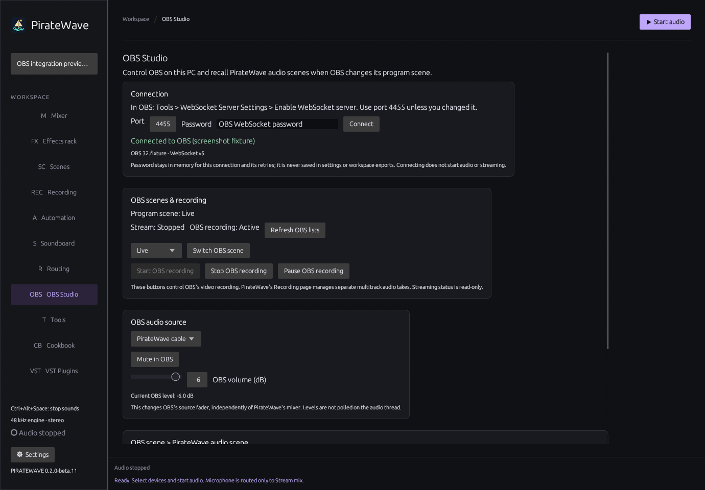
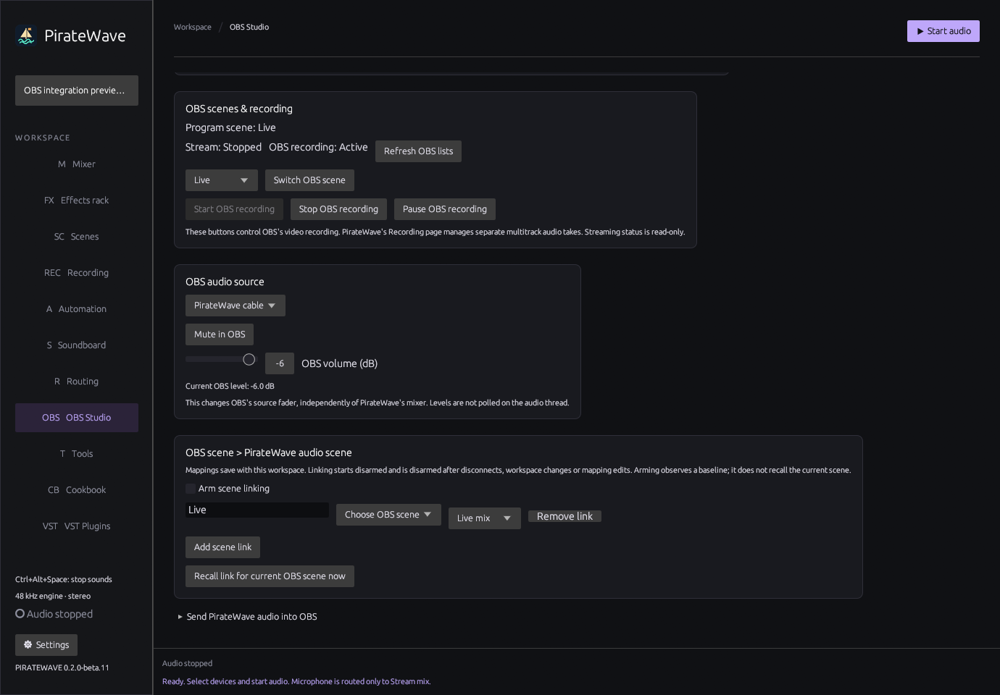

# OBS Studio integration

Open **OBS Studio** in PirateWave's sidebar. It controls OBS on the same PC through WebSocket v5, included with OBS Studio 28 and newer. No extra OBS plugin is required. Audio still travels through your chosen audio devices.

## Connect

1. In OBS, open **Tools → WebSocket Server Settings**.
2. Enable the WebSocket server. Keep authentication enabled and copy its password from **Show Connect Info**.
3. In PirateWave's **OBS Studio** page, enter the same port (normally **4455**) and password, then click **Connect**.
4. Check the connection status and current program scene.

The client connects only to `127.0.0.1`; remote-PC connections are outside this integration. The port is remembered. The password stays in memory for this connection and its retries; it is never saved in settings, workspaces or exports. **Disconnect** clears the password field. Enter it again after restarting PirateWave.

Opening the page does not connect automatically, change routes, start PirateWave audio, or start streaming.



## Controls

- See the current program scene, OBS recording/paused state and streaming status.
- Choose a scene and click **Switch OBS scene**. This changes the live program scene, including when Studio Mode is enabled; it does not just select a preview.
- Start, stop, pause or resume **OBS video recording**. PirateWave's **Recording** page continues to manage separate multitrack audio takes. Controlling one does not automatically start or stop the other.
- Choose an **OBS audio source** to mute/unmute it or set its OBS volume between −100 and 0 dB. The slider sends its final value when released. The displayed current level comes from OBS. Non-audio sources do not expose these controls.
- **Refresh OBS lists** reloads scenes and sources. State also follows OBS events and lightweight periodic queries.

OBS source gain is independent of PirateWave's mix and monitoring gain. Streaming is read-only status; there is no start-stream button.

## Link OBS scenes to audio scenes

For example, create a **Live mix** scene and a **Break mix** scene in PirateWave. The latter could mute the microphone and lower music.

1. Create the desired audio scenes on PirateWave's **Scenes** page.
2. Open **OBS Studio**, click **Add scene link**, choose the exact OBS scene name, and choose its PirateWave audio scene.
3. Add a link for each OBS scene you want to follow. Each OBS name can have one link. PirateWave targets use stable IDs, so renaming an audio scene preserves its link.
4. Enable **Arm scene linking**. PirateWave obtains a baseline before arming; arming does not recall the current scene.
5. Change OBS's program scene. PirateWave recalls the linked audio scene through its shared dispatcher and normal transitions.

**Recall link for current OBS scene now** deliberately applies the current mapping immediately. Unmapped OBS scenes leave the mix alone. Missing audio scenes or incompatible controls produce visible errors rather than partial recalls. Renaming an OBS scene requires updating its exact name in the mapping. Mappings apply to the current OBS scene collection.

Mappings autosave with the workspace and survive export/import. Credentials and armed state do not. Linking starts disarmed and disarms after disconnects, workspace switches or mapping edits. Reconnect and re-arm when appropriate; earlier scene changes are not replayed. OBS integration is independent of the external-controller setting.



## Send PirateWave audio into OBS

WebSocket carries controls, not audio. Use the free [VB-CABLE](https://vb-audio.com/Cable/) driver if you do not already have a suitable virtual device:

1. Install VB-CABLE using its setup program and restart Windows if requested.
2. In PirateWave, choose **CABLE Input (VB-Audio Virtual Cable)** for the **Stream Mix** output bus. Route the desired sources into that bus.
3. In OBS Sources, add **Audio Input Capture**, create a source such as **PirateWave mix**, and select **CABLE Output (VB-Audio Virtual Cable)**.
4. Start PirateWave audio and check OBS's meter.
5. Disable duplicate OBS Desktop Audio/Mic-Aux captures for signals already included in Stream Mix, or you may hear doubled audio. Leave OBS monitoring off for the cable source unless you specifically need another monitor path. Use headphones on PirateWave's Monitor bus.

PirateWave sends to **CABLE Input**; OBS receives from **CABLE Output**. The virtual cable carries audio independently of the control connection.

## Troubleshooting

- **Connection refused / reconnecting:** start OBS, enable its WebSocket server, and check the port. Transient disconnects retry with bounded backoff. Bad authentication, incompatible RPC, or an OBS-revoked connection requires manual reconnection.
- **Source controls unavailable:** select an audio source. Removed or renamed sources must be selected again.
- **Scene link does nothing:** connect, arm linking, then make a new program-scene change. Check exact names, the current collection, and missing audio scenes.
- **Request failed:** read the status. A queued request is not a completed operation. If a connection drops after sending a command, check OBS before retrying: the command may already have been applied.
- **No audio:** check both cable endpoints and meters. A successful control connection does not configure the cable or start PirateWave audio.

## Development and validation

`src/obs.rs` implements the bounded client; `src/ui/obs.rs` owns controls and link arming. Workspace mappings default to empty. Socket I/O, authentication, JSON and queries stay outside audio rendering. There are no audio-meter subscriptions or render-thread polling. Limits are 64 queued commands/events, 32 requests in flight, and 1 MiB frames/messages. Timeouts discard pending work; reconnection never replays commands. Connection/workspace generations reject stale work.

Tests use real local TCP/WebSocket fixtures. They cover authentication, status and controls, events, stale generations, timeouts/reconnect without replay, authentication/revocation errors, queue limits, persistence and link arming. Native screenshot fixtures cover offline, connected-simulation and narrow layouts without connecting to OBS or modifying user settings. Actual OBS UI/device/streaming behavior needs separate qualification on the intended setup.

```powershell
cargo test --bin piratewave-desktop obs:: --locked
cargo test --workspace --all-targets --locked
cargo clippy --workspace --all-targets --locked -- -D warnings
cargo build --locked
./target/debug/piratewave-desktop.exe --obs-ui-smoke
```

References: [OBS remote-control guide](https://obsproject.com/kb/remote-control-guide), [official WebSocket v5 protocol](https://github.com/obsproject/obs-websocket/blob/master/docs/generated/protocol.md).
