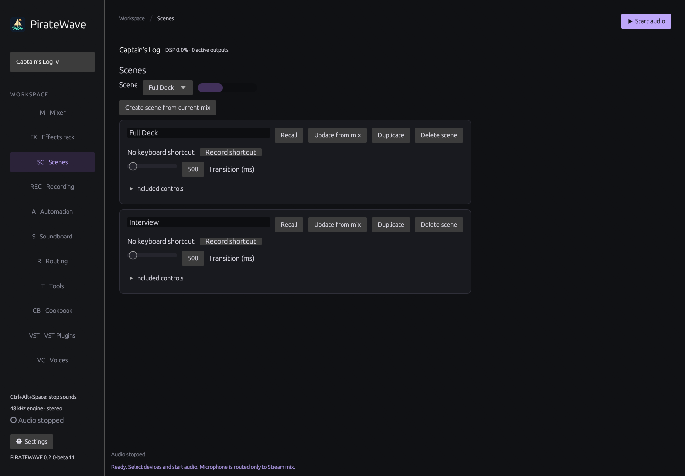
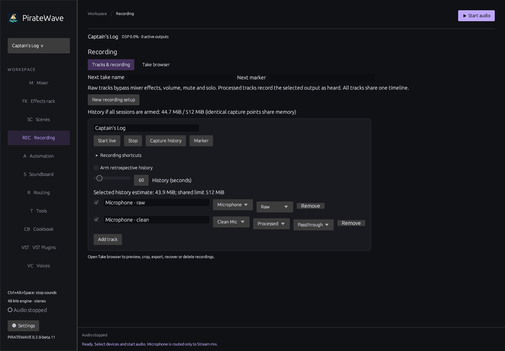
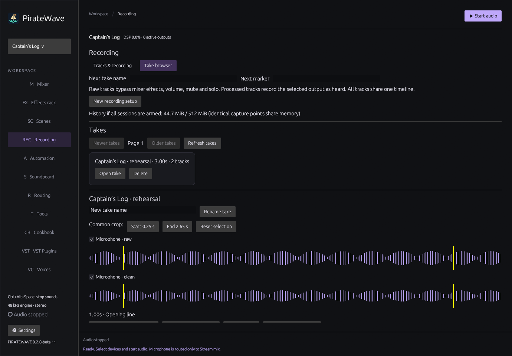
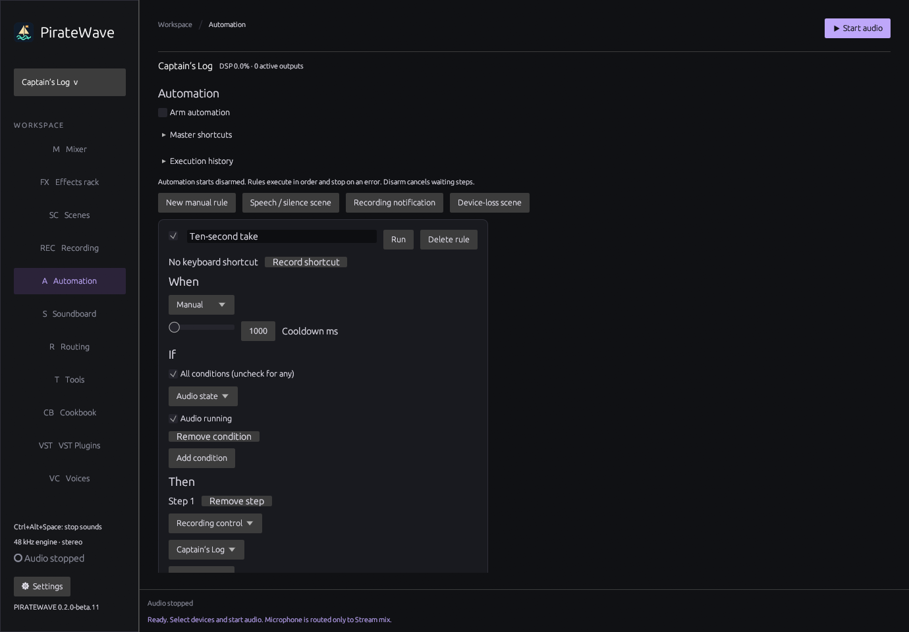

# Scenes, sessions and automation

These pages work with your current workspace. They do not replace recording nodes or require controller shortcuts.

## Recall a mix with Scenes

1. Set up the mix you want on Mixer and Effects rack.
2. Open **Scenes** and choose **Create scene from current mix**. Give it a unique name.
3. Set **Transition (ms)**. The default is half a second; the maximum is ten seconds.
4. Expand **Included controls** to exclude a whole node or individual controls.
5. Make a different mix and save another scene. Use **Recall** or the compact scene selector on Mixer to switch between them.

**Update from mix** replaces a scene's values while preserving its name, transition time, shortcut and matching exclusions. **Duplicate** creates a separately editable scene. Deleting a scene removes its shortcut registration when shortcuts refresh.

Scenes remember volume, pan, mute, solo, output listening, rack/effect bypass, built-in effect parameters, switch destinations and Auto Ducking settings. They keep routing, devices and effect order intact. VST/extension parameters, plugin state, voice model choices, playback and recording commands are excluded. Additional built-in effects on those nodes remain eligible.

Volume moves smoothly in dB; pan moves linearly. Switch destinations crossfade. Other settings that cannot safely interpolate change during a short fade. Existing device streams and DSP instances are retained. Enabling secondary listening can open its configured monitoring stream. Voice Changer activation retains its ordinary model-loading/priming behavior; scenes do not preload voices or recall plugin presets.

A new recall replaces the previous transition, starting at the current values. Moving a control takes ownership of that control; the other scene controls keep moving. The selector shows progress and **Modified** after included settings are edited. Relative controller changes start from the current interpolated value. If a target was deleted or replaced, recall fails before applying any included setting. Exclude the missing control or update the scene to fix it.

## Record synchronized tracks with Recording

Use **Recording → Tracks & recording → New recording setup**. Add up to 32 tracks, give them unique names and tick the tracks you want to record.

For each track, select a node and capture point:

- **Raw source** records before source effects, volume, pan, mute and solo. A muted microphone can still be recorded raw.
- **Processed output** records after the node's processing. Auto Ducking exposes Mixed/Passthrough, Priority and Ducked. Recording nodes expose Passthrough, Preview and Send. Extension output ports are selectable too.

You can record raw and processed versions of one microphone together. Tracks share an engine timeline; they retain the delay already introduced by a plugin or voice converter. PirateWave does not shift tracks to hide that latency.

### Live recording

1. Start PirateWave audio.
2. Enter an optional **Next take name**.
3. Click **Start live**. Recording begins when the file worker and engine confirm that the take is ready.
4. Add markers with **Marker**. You can enter a name in **Next marker** first.
5. Click **Stop** and allow finalization to finish.

Live recording starts with new audio; it does not include earlier history. Track selection and capture-point changes are locked during recording/finalization. Mixer adjustments and scene recalls remain available and are recorded at the chosen capture points. One live take can run at a time. A retrospective capture can run alongside it.

### Capture recent history

1. Set **History (seconds)**, normally 60 seconds.
2. Review the memory estimate, then enable **Arm retrospective history**.
3. Wait for audio to accumulate and click **Capture history**.

History supports up to ten minutes, within a shared 512 MiB limit. Identical capture points share one buffer at the longest required duration, including existing recording-node histories. Pending captures still count if they retain old buffers. If the requested configuration exceeds the limit, reduce the duration or disarm other histories. Arming history is temporary and does not resume after a workspace switch or restart.

Capture uses one common end frame and duration across every selected track. If buffers are still filling, the take uses the common available duration. If history becomes unavailable during export, capture fails explicitly rather than saving mismatched tracks.

### Review and export

Open **Take browser**, then **Open take**. The lanes share a playhead and crop selection. Change Start/End, drag a selection boundary or use Reset selection. Selection edits stop preview.

Select the lanes you want to hear, choose a **monitoring device**, then click **Preview selected tracks**. The lanes are summed only for preview; the routing graph is not involved. Preview streams from disk. **Export selected interval** writes a new folder with synchronized 48 kHz stereo float WAV files and a manifest. Large tracks use RF64 automatically. The original take stays intact. **Rename take** changes its label. **Delete** requires confirmation; media referenced by another workspace is kept.

Take files live in PirateWave's application-data `takes` directory, outside workspace JSON. Workspace export carries references, not audio files. Export take folders separately when moving recordings to another computer. An unavailable reference is reported in Take browser. Older takes are paged to keep the browser's memory use bounded.

### Interruptions and recovery

A disconnected input records aligned silence while the audio engine continues. The manifest records discontinuities. Disk errors or a full transfer queue stop the affected take and display an error; audio rendering never waits for disk writes.

Switching workspaces first stops an active take and waits for finalization. Pending old-workspace captures are cancelled, and old replies cannot restore deleted targets. If finalization cannot finish promptly, the switch continues with a visible error and recoverable files.

After an interrupted recording, PirateWave offers **Open recording recovery**. In Take browser, choose a recovery destination session and click **Recover**. Recovery trims all tracks to their common available length and repairs their headers. If no usable audio exists, delete the interrupted take after confirmation. Recovery never invents missing samples.

## Build a guided rule with Automation

Automation always starts **disarmed**, including after imports and workspace changes.

1. Open **Automation** and add a manual rule or starter template.
2. Choose **When**: level crossing, silence, audio start/stop, scene completion, device availability, an operation completing/failing, a timer or manual invocation.
3. Add optional **If** conditions. Choose whether all or any must match.
4. Add **Then** steps: a catalog action, an absolute control setting, scene recall, session control, a notification or a wait. Reorder steps with **Move up**.
5. Review the rule, enable it and turn on **Arm automation**. Manual rules also need the master armed.

Level rules start at −35 dBFS, with 6 dB hysteresis, a 150 ms hold and a one-second cooldown. They fire on crossings rather than continuously. Arming a rule does not synthesize a crossing. Silence and timers have their own editable durations. Level summaries are consumed at 20 Hz only when armed rules need them.

The speech/silence template creates music-volume scenes and two rules; choose the intended microphone and music source before arming. The device-loss template creates **Safe Harbor** from the current mix. Configure your desired fallback mix and update that scene before relying on it. Recording notification is a simple completion-triggered rule.

A rule executes one sequence at a time. Extra triggers increment its skipped count. Steps wait for authoritative asynchronous results: a queued capture is not a completed recording, and Start/Stop recording are acknowledged at start/finalization respectively. **Execution history** shows recent steps and errors. Unresolved targets remain visible with errors.

Disarming cancels waiting steps and delays without changing the current mix. Queue saturation or a causal loop also disarms automation and reports the cause. Limits are 256 queued events, 32 steps per rule and eight causal levels. Rules cannot run commands, download files or delete recordings/takes.

## Shortcuts and controllers

Use **Record shortcut** on a scene, session action or rule. Master arm/disarm shortcuts are under **Master shortcuts**. Clearing or deleting a target removes its registration on refresh.

The refreshed Loupedeck and Stream Deck plugins have **Audio scenes**, **Multitrack sessions**, **Automation** and **Automation rules** groups. Choose PirateWave, then the scene/session/rule name and action. External assignments use exact names in the current workspace; missing or duplicate names do nothing. Existing assignments are preserved. Controllers display authoritative transition, recording and rule state, and work without keyboard bindings.

For a working example, import **Cookbook → Captain’s Log**. Its **Ten-second take** manual rule demonstrates Start → Wait → Stop → notification. Review all devices and tracks before arming or recording.

See [release validation and hardware qualification limits](WORKFLOW_VALIDATION.md).
